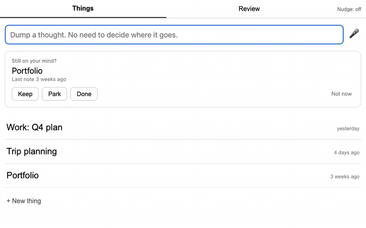
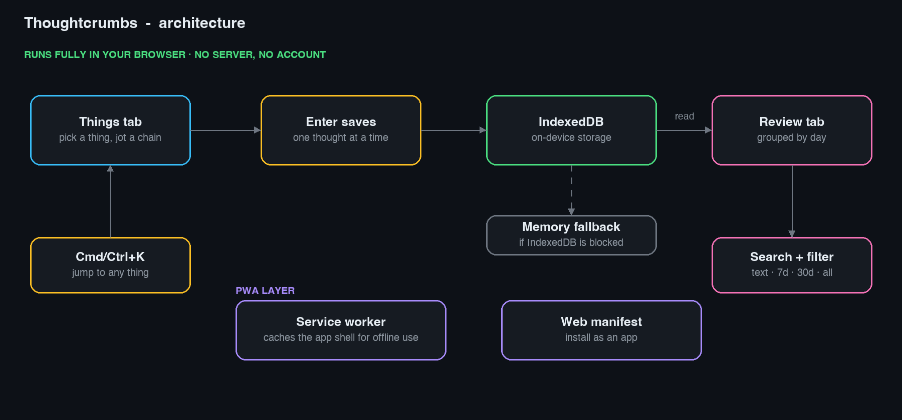

<h1 align="center">Thoughtcrumbs</h1>
<p align="center"><b>Catch your thoughts before they vanish.</b></p>

<p align="center"></p>

Your head is full of half-formed ideas, worries and "oh, I should…" moments, and they tend to arrive in chains. Thoughtcrumbs gives each chain a home: one short title per thing on your mind, and a fast place to jot everything that belongs under it.

Built for brains that get overwhelmed by words. The home screen is just your things, plain and calm, so you can see what's on your mind at a glance.

No account. No cloud. Nothing leaves your device.

## Built for busy, overloaded minds

- **Dump first, decide later:** a box at the top of Home takes any thought, no topic needed, and it's focused the moment you open the app. File it later with "Move to…" or "Make a thing"
- **Never a wall of stuff:** Home shows your 7 most recent things. The rest hide behind "Show more"
- **Lists that shrink:** mark a thing **Park** (not now) or **Done**. It leaves Home, and "Bring back" is one tap away. Every change has an Undo
- **A gentle weekly check:** once a week it asks "Still on your mind?" about the three things you haven't touched longest. Keep, Park or Done, or just "Not now". No streaks, no guilt
- **See everything at a glance:** short titles with "last note 3 weeks ago". No colours, no previews, no clutter
- **Then versus now:** open a thing and its thoughts are grouped by day, so you can see how your thinking has changed
- **Jot in a chain:** type, press Enter, and the box clears for the next thought. `Esc` takes you back home
- **Jump anywhere:** press `Cmd+K` (or `Ctrl+K`), type a few letters, and you're in that thing. Typing a new name makes a new thing
- **A soft nudge:** turn on "Nudge" and get a quiet "Anything on your mind?" about once an hour, never between 10 pm and 7 am
- **Calm by default:** plain black and white, and no animations if your system asks for reduced motion
- **Truly private:** your entries live in your browser and nowhere else
- **Works like a real app:** install it on your desktop, and it keeps working offline

## How it works

<p align="center"></p>

## Run it

You need [Node.js](https://nodejs.org/) 18 or later and a modern browser (Chrome, Edge or Safari).

```bash
git clone https://github.com/Athulya-cloud/thoughtcrumbs.git
cd thoughtcrumbs
npm install
npm run serve
```

Open the URL it prints (for example http://localhost:3000).

Stop the server with `Ctrl+C`. Your entries are not affected because they live in the browser.

## Install it as an app

- **Chrome / Edge (desktop):** click the install icon in the address bar
- **Chrome (Android):** menu → Add to Home screen
- **Safari (iPhone / iPad):** Share → Add to Home Screen

Offline use starts from your second visit, once the service worker has installed.

**Forget to open it?** Keep it pinned as an installed app and switch Nudge on. The nudge only works while the app is open or running in the background, because a browser can't wake a closed app.

## Tests

```bash
npm test
```

## Tech stack

Plain JavaScript (no framework), IndexedDB, a service worker and a web manifest. Tests use Vitest.
