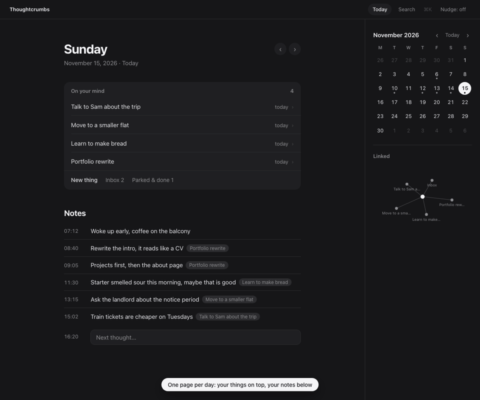
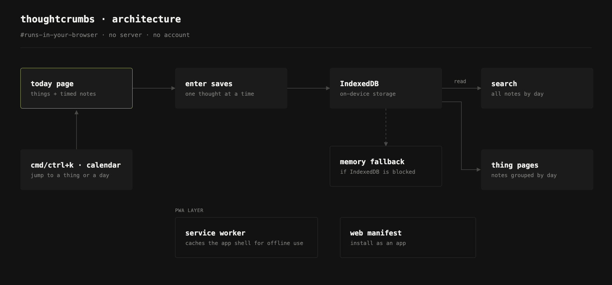

<h1 align="center">Thoughtcrumbs</h1>
<p align="center"><b>Catch your thoughts before they vanish.</b></p>

<p align="center"></p>

Your head is full of half-formed ideas, worries and "oh, I should…" moments, and they tend to arrive in chains. Thoughtcrumbs gives each chain a home: one short title per thing on your mind, and a fast place to jot everything that belongs under it.

Built for brains that get overwhelmed by words. Each day gets one quiet page: the things on your mind at the top, and below them a running list of timestamped notes, like `14:05 - call the dentist`.

No account. No cloud. Nothing leaves your device.

## Built for busy, overloaded minds

- **Dump first, decide later:** the field at the bottom of today's page takes any thought, no topic needed, and it's focused the moment you open the app. Each note gets the time it was written. File it later from the inbox with "Move to…" or "Make a thing"
- **Never a wall of stuff:** today's page shows your 7 most recent things. The rest hide behind "Show more"
- **Lists that shrink:** mark a thing **Park** (not now) or **Done**. It leaves today's list (done things stay struck through until the day ends), and "Bring back" is one tap away. Every change has an Undo
- **A gentle weekly check:** once a week it asks "Still on your mind?" about the three things you haven't touched longest. Keep, Park or Done, or just "Not now". No streaks, no guilt
- **See everything at a glance:** short titles with "last note 3 weeks ago". No colours, no previews, no clutter
- **Then versus now:** open a thing and its notes are grouped by day, so you can see how your thinking has changed
- **Move between days:** a month calendar in the sidebar marks the days you wrote something. Pick one to read that day's page, or step with the ‹ › buttons next to the day's name. A small graph shows which things a day touched
- **Jot in a chain:** type, press Enter, and the line clears for the next thought. `Esc` takes you back to today
- **Jump anywhere:** press `Cmd+K` (or `Ctrl+K`), type a few letters, and you're in that thing. Typing a new name makes a new thing
- **A soft nudge:** turn on "Nudge" and get a quiet "Anything on your mind?" about once an hour, never between 10 pm and 7 am
- **Calm by default:** quiet greys, Apple's system font, one narrow column and lots of empty space. It follows your system's light mode, and has no animations
- **Truly private:** your entries live in your browser and nowhere else
- **Works like a real app:** install it on your desktop, and it keeps working offline

## How it works

<p align="center"></p>

## Run it

You need [Node.js](https://nodejs.org/) 18 or later and a modern browser (Chrome, Edge or Safari).

```bash
git clone https://github.com/Athulya-cloud/thoughtcrumbs.git
cd thoughtcrumbs
npm install
npm run serve
```

Open the URL it prints (for example http://localhost:3000).

Stop the server with `Ctrl+C`. Your entries are not affected because they live in the browser.

## Install it as an app

- **Chrome / Edge (desktop):** click the install icon in the address bar
- **Chrome (Android):** menu → Add to Home screen
- **Safari (iPhone / iPad):** Share → Add to Home Screen

Offline use starts from your second visit, once the service worker has installed.

**Forget to open it?** Keep it pinned as an installed app and switch Nudge on. The nudge only works while the app is open or running in the background, because a browser can't wake a closed app.

## Tests

```bash
npm test
```

## Tech stack

Plain JavaScript (no framework), IndexedDB, a service worker and a web manifest. Tests use Vitest.
